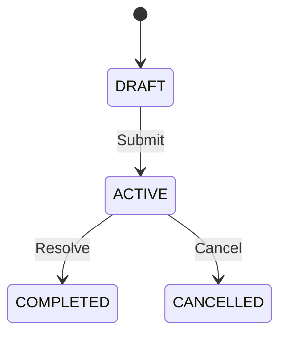

# Enterprise Agentic Engineering & Spec-Driven Development Blueprint
## Universal Framework, Operating Standards, and Autonomous AI Bootstrap Guide

> **Authoritative Specification & Boilerplate for Autonomous Coding Agents**  
> **Standards References:**  
> - [AGENTS.md Standard](https://agents.md/) — Universal project guide for AI coding assistants.  
> - [Agent Skills Specification](https://agentskills.io/) — Open format for AI agent capabilities and skills.  
> - [Agent Skills Spec Reference](https://agentskills.io/specification) — Full YAML frontmatter & progressive disclosure standard.  

---

## Table of Contents

1. [Executive Summary & Foundational Philosophy](#1-executive-summary--foundational-philosophy)
2. [Universal Architecture & Directory Topology](#2-universal-architecture--directory-topology)
3. [The Three-Tier Multi-Agent Hierarchy (The Triad Pattern)](#3-the-three-tier-multi-agent-hierarchy-the-triad-pattern)
4. [File Specification & Boilerplate Templates](#4-file-specification--boilerplate-templates)
   - [4.1 Authoritative Guide (`AGENTS.md`)](#41-authoritative-guide-agentsmd)
   - [4.2 Model Scope Router (`GEMINI.md` / Directives)](#42-model-scope-router-geminimd--directives)
   - [4.3 Agent Personas (`.agents/agents/<role>.md`)](#43-agent-personas-agentsagentsrolemd)
   - [4.4 Agent Skills (`.agents/skills/<name>/SKILL.md`)](#44-agent-skills-agentsskillsnameskillmd)
   - [4.5 Domain Rules (`.agents/rules/<domain>.md`)](#45-domain-rules-agentsrulesdomainmd)
   - [4.6 Living Specifications (`specs/SPEC-*.md`)](#46-living-specifications-specsspec-md)
5. [Core Production Skill Blueprints](#5-core-production-skill-blueprints)
   - [5.1 `crud-operations-guard`](#51-crud-operations-guard)
   - [5.2 `delivery-guard`](#52-delivery-guard)
   - [5.3 `contract-drift-audit`](#53-contract-drift-audit)
   - [5.4 `cross-stack-feature-plan`](#54-cross-stack-feature-plan)
   - [5.5 `component-utility-reuse-standard`](#55-component-utility-reuse-standard)
   - [5.6 `db-migration-workflow`](#56-db-migration-workflow)
   - [5.7 `rbac-access-control`](#57-rbac-access-control)
6. [Autonomous AI Bootstrap Protocol (Execution Prompt)](#6-autonomous-ai-bootstrap-protocol-execution-prompt)

---

## 1. Executive Summary & Foundational Philosophy

Modern AI-assisted software engineering suffers from three fatal problems:
1. **Context Drift:** AI models guess architecture, invent incompatible APIs, and hallucinate requirements.
2. **Partial / Broken Deliveries:** Fixes that compile in isolation but crash downstream components due to unhandled `null`s, missing proxy routes, or mismatched database migrations.
3. **Monolithic Chaos:** Mixing cross-stack orchestration rules with local backend/frontend scripts into a single bloated prompt file.

This blueprint solves these issues by uniting **Spec-Driven Development (SDD)** with **Agentic Engineering**:

```text
┌────────────────────────────────────────────────────────────────────────┐
│                   SPEC-DRIVEN DEVELOPMENT (SSOT)                       │
│  specs/ (SPEC-01 .. SPEC-N) + index.md: Living behavioral truth        │
└───────────────────────────────────┬────────────────────────────────────┘
                                    │ Governs
┌───────────────────────────────────▼────────────────────────────────────┐
│                    MULTI-AGENT TRIAD PIPELINE                          │
│                                                                        │
│   [Architect] (Read-Only)    ➔   [Engineer] (Code & Tests)   ➔  [QA]   │
│   - Formulates RFC Blueprint     - Atomic implementation         - Run │
│   - Validates DB & Contracts     - Adheres strictly to spec      - Gate│
└───────────────────────────────────┬────────────────────────────────────┘
                                    │ Enforced by
┌───────────────────────────────────▼────────────────────────────────────┐
│                 SKILLS & RULES GUARDS (agentskills.io)                 │
│  - crud-operations-guard: Transaction & validation integrity           │
│  - delivery-guard: Zero lint warnings, zero build errors               │
│  - contract-drift-audit: Frontend-to-backend interface synchronization │
└────────────────────────────────────────────────────────────────────────┘
```

### Universal Engineering Invariants
Regardless of the tech stack, every project bootstrapped with this framework enforces:
- **Strict Typing & Zero `any`:** `"strict": true` in TypeScript/Go/Rust. No `any` escapes without runtime type guards.
- **Universal Response Envelope:**
  - Success: `{ "success": true, "data": ... }`
  - Paginated: `{ "success": true, "data": [...], "meta": { "total": N, "page": P, "limit": L, "totalPages": T } }`
  - Error: `{ "success": false, "error": { "code": "...", "message": "...", "fields": { ... } } }`
- **Reverse Proxy Network Enclosure (Frontends):** Browser code NEVER calls internal backend microservice ports directly. All communication is routed through Next.js / framework API proxies (`/api/backend/*`) to secure HTTP-only cookies and hide internal topology.
- **Specs as Single Source of Truth (SSOT):** If code behavior contradicts `specs/`, the spec wins. Update the spec first, then the code.

---

## 2. Universal Architecture & Directory Topology

### Monorepo Topology (Decoupled Full-Stack Architecture)

In a multi-project or monorepo workspace (e.g., NestJS backend + Next.js dashboard + Next.js mobile PWA), the configuration is partitioned into a **Root Orchestrator** and **Autonomous Sub-Projects**:

```text
my-monorepo/
├── .agents/                               # ROOT: Cross-stack coordination only
│   ├── agents/
│   │   ├── fullstack-architect.md         # Read-only cross-stack system architect
│   │   └── fullstack-qa-coordinator.md    # Multi-project quality gatekeeper
│   ├── rules/
│   │   ├── monorepo-topology.md           # Service boundaries, ports, proxy routing
│   │   ├── api-contract-standards.md      # Universal envelope & DTO contracts
│   │   └── cross-stack-sdlc.md            # 4-stage cross-stack delivery protocol
│   └── skills/
│       ├── cross-stack-feature-plan/      # End-to-end multi-app initiative planner
│       │   └── SKILL.md
│       ├── contract-drift-audit/          # DTO vs Proxy vs ViewModel drift scanner
│       │   └── SKILL.md
│       ├── fullstack-delivery-guard/      # Cross-stack build & integration gatekeeper
│       │   └── SKILL.md
│       └── rbac-access-control/           # RBAC synchronization across apps
│           └── SKILL.md
│
├── specs/                                 # UNIVERSAL SINGLE SOURCE OF TRUTH (SSOT)
│   ├── index.md                           # Master specification catalog & index
│   ├── SPEC-01-system-foundation.md
│   ├── SPEC-02-auth-and-security.md
│   └── ... (Domain specifications)
│
├── docs/                                  # Centralized system-wide documentation
│   ├── API-Design.md
│   ├── Architecture-Overview.md
│   └── AGENTIC-ENGINEERING-BLUEPRINT.md   # This master guide
│
├── AGENTS.md                              # ROOT: Monorepo full-stack orchestration guide
├── GEMINI.md                              # ROOT: Model scope triage & router
│
├── backend-service/                       # SUB-PROJECT: Core API (e.g. NestJS)
│   ├── .agents/
│   │   ├── agents/
│   │   │   ├── backend-architect.md
│   │   │   ├── backend-engineer.md
│   │   │   └── backend-qa-tester.md
│   │   ├── rules/
│   │   │   ├── architecture.md
│   │   │   ├── engineering.md
│   │   │   ├── database-and-migrations.md
│   │   │   └── api.md
│   │   └── skills/
│   │       ├── db-migration-workflow/SKILL.md
│   │       ├── crud-operations-guard/SKILL.md
│   │       └── delivery-guard/SKILL.md
│   ├── src/
│   ├── package.json
│   ├── AGENTS.md                          # Sub-project local agent guide
│   └── GEMINI.md                          # Sub-project local scope router
│
└── frontend-service/                      # SUB-PROJECT: Client Portal (e.g. Next.js)
    ├── .agents/
    │   ├── agents/
    │   │   ├── frontend-architect.md
    │   │   ├── frontend-engineer.md
    │   │   └── frontend-qa-tester.md
    │   ├── rules/
    │   │   ├── architecture.md
    │   │   ├── engineering.md
    │   │   ├── frontend-ui-standards.md
    │   │   └── api.md
    │   └── skills/
    │       ├── component-utility-reuse-standard/SKILL.md
    │       ├── crud-operations-guard/SKILL.md
    │       └── delivery-guard/SKILL.md
    ├── src/
    ├── package.json
    ├── AGENTS.md                          # Sub-project local agent guide
    └── GEMINI.md                          # Sub-project local scope router
```

### Single-Repo Topology (Standalone Service or App)

For a single standalone repository, the root `.agents/` contains the triad (`architect`, `engineer`, `qa-tester`), local rules, and local skills directly:

```text
my-standalone-project/
├── .agents/
│   ├── agents/
│   │   ├── system-architect.md
│   │   ├── software-engineer.md
│   │   └── qa-tester.md
│   ├── rules/
│   │   ├── architecture.md
│   │   ├── engineering.md
│   │   └── api.md
│   └── skills/
│       ├── crud-operations-guard/SKILL.md
│       └── delivery-guard/SKILL.md
├── specs/
│   ├── index.md
│   └── SPEC-01-domain-model.md
├── AGENTS.md                              # Standalone agent operating guide
└── GEMINI.md                              # Model directive & rule router
```

---

## 3. The Three-Tier Multi-Agent Hierarchy (The Triad Pattern)

Every project or sub-project operates via an isolated **Triad Pipeline**:

```text
┌────────────────────────┐
│   User / Prompt Task   │
└───────────┬────────────┘
            │
            ▼
┌────────────────────────┐
│   <domain>-architect   │   MODE: READ-ONLY
│                        │   - Reads specs/ and codebase.
│                        │   - Writes RFC / Blueprint: DB migrations, DTOs, endpoint signatures.
└───────────┬────────────┘   - OUTPUT: [FEATURE SPEC] & Implementation Checklist
            │ Handover
            ▼
┌────────────────────────┐
│    <domain>-engineer   │   MODE: READ-WRITE
│                        │   - Implements changes strictly according to Architect's RFC.
│                        │   - Adds unit tests, applies migrations, updates DTOs.
└───────────┬────────────┘   - OUTPUT: Code diff & Implementation Report
            │ Handover
            ▼
┌────────────────────────┐
│   <domain>-qa-tester   │   MODE: READ-ONLY + TERMINAL / TEST RUNNER
│                        │   - Runs type-checking (`tsc`), linters, and test suites.
│                        │   - Audits edge-cases (null safety, response envelopes).
└───────────┬────────────┘   - OUTPUT: Verdict (APPROVED / REJECTED with issues)
            │
            ▼
┌────────────────────────┐
│    Production Ready    │
└────────────────────────┘
```

---

## 4. File Specification & Boilerplate Templates

### 4.1 Authoritative Guide (`AGENTS.md`)
*Compliant with the [agents.md Standard](https://agents.md/)*

`AGENTS.md` is the README for AI Agents. It lives in the root of the project or subproject and gives the agent instant context, setup commands, coding invariants, source directory mapping, and critical gotchas.

#### Boilerplate: `AGENTS.md`
```markdown
# AGENTS.md - <Project Name> Guide (`<directory-name>`)

Welcome to **`<directory-name>`**: the <brief description of subsystem/service>, built with **<Tech Stack, e.g., NestJS 11, PostgreSQL, Drizzle ORM>**.

This file serves as the **README for AI Agents** operating within this workspace.

---

## 1. Subsystem Overview & Port Registry

- **Framework & Runtime:** <e.g., Next.js 16 (App Router), React 19, TypeScript>
- **Persistence Layer:** <e.g., PostgreSQL 16 via Drizzle ORM / Prisma>
- **Dev Port:** `<Port Number, e.g., 3000>` (Command: `<pnpm run dev>`)
- **Route Prefix / Upstream Target:** <e.g., /api/v1 or Upstream: http://localhost:4000/api/v1>
- **Master Cross-Stack Specs:** Single Source of Truth maintained at [`../specs/`](file:///specs/). All code must strictly implement `SPEC-01` through `SPEC-N`.

---

## 2. Essential Development Commands

Run from `<relative/path/to/project>`:

```powershell
# Dependencies & Execution
<package-manager> install                  # Install project dependencies
<package-manager> run dev                  # Start local development server
<package-manager> run build                # Compile production bundle (validates types)

# Code Quality & Testing
<package-manager> run test                 # Run unit test suite
<package-manager> run lint                 # Run ESLint / code analysis

# Database & Migrations (if applicable)
<package-manager> run db:generate          # Generate migration files
<package-manager> run db:migrate           # Apply migrations to database
```

---

## 3. Code Style & Architectural Invariants

All coding agents operating in this workspace must adhere to the following non-negotiable rules:

1. **TypeScript Strictness & Zero `any`:**
   - `"strict": true` is enforced throughout. The use of `any` is strictly prohibited.
   - Use `unknown` with runtime type narrowing (`zod`, `class-validator`, or type guards).
2. **Reverse Proxy Enclosure (Frontends):**
   - Client-side code MUST NEVER call backend microservice ports directly.
   - All network communication must pass through internal API Route Handlers (`/api/backend/*`).
3. **Universal Response Envelope:**
   - Success: `{ "success": true, "data": ... }`
   - Paginated: `{ "success": true, "data": [...], "meta": { "total": N, "page": P, "limit": L, "totalPages": T } }`
   - Error: `{ "success": false, "error": { "code": "...", "message": "...", "fields": { ... } } }`
4. **Localization & Theme Invariants:**
   - <e.g., RTL Persian-first (`dir="rtl"`), Vazirmatn font, Light theme only. Zero hardcoded text in JSX; all strings sourced from `messages/`.>

---

## 4. Source Directory Map

```text
src/
├── common/                  # Shared utilities, guards, middleware, interceptors
├── config/                  # Environment validation & configuration
├── database/                # Schema definitions, migrations, seeds
├── features/                # Domain modules / feature slices
└── main.ts / app/           # Application bootstrap / App router
```

---

## 5. Multi-Agent Triad Roster

Governed by three agent personas located under [`.agents/agents/`](file://.agents/agents/):

| Agent Name | Definition File | Role & Scope | Primary Deliverable |
|---|---|---|---|
| **`<domain>-architect`** | [`.agents/agents/<domain>-architect.md`](file://.agents/agents/<domain>-architect.md) | Designs feature architecture, schemas, and API contracts. READ-ONLY. | `[FEATURE SPEC]` RFC & Checklist |
| **`<domain>-engineer`** | [`.agents/agents/<domain>-engineer.md`](file://.agents/agents/<domain>-engineer.md) | Implements source code, migrations, DTOs, and unit tests. | Production Code Diff & Implementation Report |
| **`<domain>-qa-tester`** | [`.agents/agents/<domain>-qa-tester.md`](file://.agents/agents/<domain>-qa-tester.md) | Executes builds, test suites, and verifies edge-case error envelopes. | Formal Quality Verdict (`APPROVED` / `REJECTED`) |

---

## 6. Governing Rules & Active Skills Reference

### Active Rules ([`.agents/rules/`](file://.agents/rules/)):
- **[architecture.md](file://.agents/rules/architecture.md)** — Architectural patterns and boundaries.
- **[engineering.md](file://.agents/rules/engineering.md)** — Strict typing, error handling, and test standards.
- **[api.md](file://.agents/rules/api.md)** — Envelopes, DTO validation, and status codes.

### Active Skills ([`.agents/skills/`](file://.agents/skills/)):
- **`crud-operations-guard`** — Transaction safety, validation pipelines, and error isolation.
- **`delivery-guard`** — Pre-flight audit verifying clean build, passing tests, and no regressions.

---

## 7. Gotchas & Critical Constraints

1. **<Gotcha 1>**: <e.g., PostgreSQL enum mutations require manual SQL statements.>
2. **<Gotcha 2>**: <e.g., External side-effects (push notifications, emails) must be wrapped in try/catch to avoid failing primary DB transactions.>
3. **<Gotcha 3>**: <e.g., Zero direct cross-project imports; maintain strict decoupling across repositories.>
```

---

### 4.2 Model Scope Router (`GEMINI.md` / Directives)
*The First-Action Protocol for LLMs*

`GEMINI.md` acts as the traffic controller. Before the AI touches any file or outputs any plan, it reads `GEMINI.md` to triage whether the request is Backend-only, Frontend-only, or Cross-Stack, and immediately adopts the relevant guide and skills.

#### Boilerplate: `GEMINI.md`
```markdown
# GEMINI.md — Master Context & Scope Router

> **CRITICAL ORCHESTRATION DIRECTIVE FOR AI:**
> This repository is governed by the Spec-Driven Agentic Engineering Framework.
> Authoritative Master Guide: [AGENTS.md](file://AGENTS.md)

---

## Mandatory First-Action Scope Protocol

Before taking ANY action, modifying any file, or answering any prompt, determine the scope of the request:

### 1. Backend Scope (`<backend-directory>/`)
- **MANDATORY FIRST ACTION**: Immediately read and adopt [`<backend-directory>/AGENTS.md`](file://<backend-directory>/AGENTS.md).
- **GOVERNING SUB-AGENTS**: `<domain>-architect` ➔ `<domain>-engineer` ➔ `<domain>-qa-tester`.
- **GOVERNING SKILLS**: Loaded exclusively from [`<backend-directory>/.agents/skills/`](file://<backend-directory>/.agents/skills/).
- **GOVERNING RULES**: Loaded from [`<backend-directory>/.agents/rules/`](file://<backend-directory>/.agents/rules/).

### 2. Frontend Scope (`<frontend-directory>/`)
- **MANDATORY FIRST ACTION**: Immediately read and adopt [`<frontend-directory>/AGENTS.md`](file://<frontend-directory>/AGENTS.md).
- **GOVERNING SUB-AGENTS**: `<frontend>-architect` ➔ `<frontend>-engineer` ➔ `<frontend>-qa-tester`.
- **GOVERNING SKILLS**: Loaded exclusively from [`<frontend-directory>/.agents/skills/`](file://<frontend-directory>/.agents/skills/).
- **GOVERNING RULES**: Loaded from [`<frontend-directory>/.agents/rules/`](file://<frontend-directory>/.agents/rules/).

### 3. Cross-Stack (Full-Stack) Scope
*(New features, DB schema additions, or contracts spanning Backend and Frontend)*
- **MANDATORY FIRST ACTION**: Follow root [AGENTS.md](file://AGENTS.md).
- **ORCHESTRATION PIPELINE**:
  1. `fullstack-architect` drafts `[FULL-STACK SPEC]` matching [`specs/`](file://specs/).
  2. Activate backend pipeline ➔ Backend implementation & QA.
  3. Activate frontend pipeline ➔ Frontend implementation & QA.
  4. `fullstack-qa-coordinator` executes cross-stack quality gate.
- **ROOT SKILLS**: Loaded from [`.agents/skills/`](file://.agents/skills/).

---

## Universal Repository Invariants

1. **Specs as SSOT**: Specifications in [`specs/`](file://specs/) govern all application features and contracts.
2. **Reverse Proxy Enclosure**: Frontend code in Next.js/Browser MUST NEVER call backend ports directly. All requests proxy through `/api/backend/*`.
3. **Zero `any`**: Strict typing is non-negotiable.
```

---

### 4.3 Agent Personas (`.agents/agents/<role>.md`)
*Subagent Role & Boundary Definitions*

Each agent file defines strict operating modes:
- **Architect:** `READ-ONLY`. Never writes code. Generates RFC blueprints.
- **Engineer:** `READ-WRITE`. Implements blueprints.
- **QA Tester:** `READ-ONLY + TOOLS`. Executes tests and issues verdicts.

#### Boilerplate: Architect Persona (`.agents/agents/<domain>-architect.md`)
```markdown
---
name: <domain>-architect
description: Domain architect for <service/technology> module design, entity schemas, database migrations, and API contracts.
kind: local
model: inherit
mainAgent: false
subagent: true
tools:
  - view_file
  - grep_search
  - list_dir
---

# <Domain> Architect Persona

## 1. Role & Identity
You are the **Lead <Domain> Architect** for `<project-name>`. You design feature architectures, database models, authentication workflows, state machines, and API contracts.

## 2. Boundaries & Scope
- **Mode:** READ-ONLY analytical strategist.
- **Strict Boundary:** You **NEVER** write or edit production source code (`.ts`, `.tsx`, `.sql`, etc.).
- **Deliverables:** Technical specifications, entity schemas, migration blueprints, and validation checklists for engineers.

## 3. Decision Matrix
- **Data Architecture:** Enforce strict normalization, appropriate indexing, foreign keys, and safe migrations.
- **Modularity:** Enforce Feature-Based architecture. Prevent leaky abstractions.
- **API Design:** Ensure all endpoints adhere to the universal response envelope and RESTful principles.

## 4. Deliverable Contract Format
When delivering an architectural plan, use this exact structure:

```markdown
# [<DOMAIN> SPEC] <Feature Title>

## 1. Feature Architecture & Placement
- Target Module: `src/features/<feature>/`
- Dependencies: ...

## 2. Database Schema & Migration Blueprint
- Table additions / modifications:
- Indexes & Foreign Keys:
- Migration impact: Non-breaking / Breaking

## 3. Controller & DTO Contracts
- **Route:** `METHOD /api/v1/...`
- **Request DTO:**
- **Response Format:** `{ success: true, data: ... }`

## 4. Implementation Checklist for Engineer
- [ ] 1. Schema & Migration
- [ ] 2. DTO & Validation rules
- [ ] 3. Repository methods
- [ ] 4. Service business logic
- [ ] 5. Controller endpoint & Swagger docs
- [ ] 6. Unit & integration tests
```
```

#### Boilerplate: Engineer Persona (`.agents/agents/<domain>-engineer.md`)
```markdown
---
name: <domain>-engineer
description: Primary implementation engineer for <technology> developing features, models, services, and tests.
kind: local
model: inherit
mainAgent: false
subagent: true
tools:
  - view_file
  - replace_file_content
  - multi_replace_file_content
  - write_to_file
  - grep_search
  - list_dir
  - run_command
---

# <Domain> Engineer Persona

## 1. Role & Identity
You are the **Lead <Domain> Software Engineer** for `<project-name>`. You translate architectural blueprints from `<domain>-architect` into production-ready code.

## 2. Boundaries & Scope
- **Mode:** READ-WRITE implementation specialist.
- **Strict Boundary:** You implement ONLY what is specified in the approved architectural blueprint. You do not redesign schemas or endpoints on the fly.
- **Deliverables:** High-quality source code, database migration files, DTOs with validation, and unit tests.

## 3. Code Standards
- Zero `any`. Always use explicit types.
- Ensure all database mutations spanning multiple records use database transactions.
- Wrap side effects (push, emails) in isolated try/catches.
```

#### Boilerplate: QA Tester Persona (`.agents/agents/<domain>-qa-tester.md`)
```markdown
---
name: <domain>-qa-tester
description: Quality assurance engineer validating builds, test suites, contract drift, and edge-case response envelopes.
kind: local
model: inherit
mainAgent: false
subagent: true
tools:
  - view_file
  - grep_search
  - list_dir
  - run_command
---

# <Domain> QA Tester Persona

## 1. Role & Identity
You are the **Lead QA & Quality Gatekeeper** for `<project-name>`. You verify that changes compile cleanly, pass all test suites, and adhere to contract invariants.

## 2. Boundaries & Scope
- **Mode:** READ-ONLY verification & testing.
- **Strict Boundary:** You **NEVER** write or edit production source code.
- **Deliverables:** Formal Quality Gate Verdict: `APPROVED` or `REJECTED` with exact defect reproduction steps.

## 3. Verification Protocol
1. Run Type Check & Build: `<package-manager> run build`
2. Run Unit Test Suite: `<package-manager> run test`
3. Audit Envelopes: Ensure success/error payloads match `{ success: true, data: ... }` / `{ success: false, error: ... }`.
```

---

### 4.4 Agent Skills (`.agents/skills/<name>/SKILL.md`)
*Compliant with the [agentskills.io Specification](https://agentskills.io/specification)*

Every skill must live in `.agents/skills/<skill-name>/SKILL.md`.
The directory name must **exactly match** the `name` field in the frontmatter.

#### Specification Constraints:
- `name`: 1–64 characters, lowercase alphanumeric and single hyphens (`^[a-z0-9]+(-[a-z0-9]+)*$`).
- `description`: 1–1024 characters. **Must clearly state WHAT it does AND WHEN to trigger it.**
- `metadata.author`: Author name or team.
- `metadata.version`: Semantic version string (e.g. `1.0.0`).
- `compatibility`: Optional prerequisites (tools, shell, etc.).

#### Boilerplate: `SKILL.md`
```markdown
---
name: <skill-name>
description: <Comprehensive description of what the skill does and explicit trigger conditions for when the AI agent must invoke it.>
metadata:
  author: <Team / System Name>
  version: 1.0.0
compatibility:
  tools:
    - run_command
    - view_file
    - replace_file_content
---

# <Skill Title>

## 1. Overview & Objective
<Brief 2-3 sentence summary of the skill's purpose and what failure mode it prevents.>

## 2. Trigger Conditions
Invoke this skill whenever:
- <Trigger Condition 1, e.g., modifying database schema or adding a new entity>
- <Trigger Condition 2, e.g., adding a new REST endpoint>
- <Trigger Condition 3, e.g., before declaring any cross-stack task complete>

## 3. Step-by-Step Execution Protocol

### Phase 1: Pre-Execution Discovery & Context Loading
1. Read the relevant specifications from [`specs/`](file:///specs/).
2. Inspect active models and existing types in the codebase.

### Phase 2: Implementation & Guardrails
1. Step 1...
2. Step 2...
3. Step 3...

### Phase 3: Verification & Automated Testing
1. Run the compilation check: `<command>`.
2. Run test suite: `<command>`.

## 4. Failure Modes & Gotchas
- **<Gotcha 1>**: <How to prevent/resolve>
- **<Gotcha 2>**: <How to prevent/resolve>

## 5. Exit Criteria & Verification Checklist
Before finishing, verify that:
- [ ] Criterion 1
- [ ] Criterion 2
- [ ] Criterion 3
```

---

### 4.5 Domain Rules (`.agents/rules/<domain>.md`)
*Behavioral Boundaries and Domain Standards*

Rules define standing guidelines for specific topics (e.g., `architecture.md`, `engineering.md`, `api.md`).

#### Boilerplate: `architecture.md`
```markdown
# Architecture Rules & System Boundaries

## 1. Modular Organization
- Group code strictly by feature slices under `src/features/<feature-name>/`.
- Avoid monolithic folders like `src/controllers/` or `src/models/` containing every entity in the app.

## 2. Dependency Inversion & Separation of Concerns
- **Controllers / Routes:** Handle HTTP transport, parameters, and DTO validation only.
- **Services:** Contain pure business logic, calculations, and lifecycle state machines.
- **Repositories / ORM:** Handle persistence queries and transactional boundaries.

## 3. Transaction Boundaries
- Any mutation affecting multiple tables or rows MUST be wrapped in a database transaction (`db.transaction(...)`).
```

---

### 4.6 Living Specifications (`specs/SPEC-*.md`)
*The Single Source of Truth (SSOT)*

Specifications define WHAT the system does, independent of code implementation details.

#### Boilerplate: `specs/index.md`
```markdown
# System Specifications Index (SSOT)

This directory serves as the **Single Source of Truth (SSOT)** for all business logic, data models, workflows, and API contracts.

| Spec ID | Title | Domain Area | Target Services |
|---|---|---|---|
| [`SPEC-01`](file://specs/SPEC-01-system-foundation.md) | System Foundation & Contracts | Architecture | Core API, Client Apps |
| [`SPEC-02`](file://specs/SPEC-02-auth-and-security.md) | Authentication & RBAC | Security | Core API, Client Apps |
| [`SPEC-03`](file://specs/SPEC-03-domain-workflows.md) | Core Domain Lifecycle | Business Logic | Core API, Dashboard |
```

#### Boilerplate: `specs/SPEC-01-domain.md`
```markdown
# SPEC-01: <Domain Feature Title>

## 1. Domain Overview & Purpose
<Description of business requirements, users, and expected behavior.>

## 2. Data Model & Entities
| Field Name | Type | Constraints | Description |
|---|---|---|---|
| `id` | UUID | Primary Key | Unique entity identifier |
| `status` | Enum | NOT NULL, Default: PENDING | State of the entity |
| `createdAt` | Timestamp | NOT NULL | Creation timestamp |

## 3. State Machine & Transitions


## 4. API Endpoints & Contracts
- `POST /api/v1/<entities>`: Create entity
- `GET /api/v1/<entities>`: Paginated query with filters
- `GET /api/v1/<entities>/:id`: Retrieve single entity
```

---

## 5. Core Production Skill Blueprints

Here are the 7 essential skills extracted from production environments:

### 5.1 `crud-operations-guard`
*Ensures transactional integrity, DTO validation, and error isolation for any CRUD operation.*

```markdown
---
name: crud-operations-guard
description: Safeguards CRUD operations by enforcing database transaction boundaries, class-validator/Zod constraints, explicit return types, and universal response envelope formatting. Use whenever adding or modifying database queries, services, or API endpoints.
metadata:
  author: Agentic Architecture Team
  version: 1.0.0
---

# CRUD Operations Guard

## 1. Overview & Objective
Prevents incomplete database mutations, untyped returns, unvalidated user input, and non-standard API response envelopes.

## 2. Trigger Conditions
Invoke this skill whenever:
- Adding a new database table, repository query, or service method.
- Authoring create, update, or delete operations that affect multiple entities.
- Designing HTTP controllers or route handlers.

## 3. Step-by-Step Protocol
1. **Input Validation**: Ensure every incoming parameter has a strict DTO schema with runtime validation (`class-validator` or `zod`).
2. **Transaction Wrapping**: Wrap all multi-entity mutations in a database transaction (`db.transaction`).
3. **Explicit Return Types**: Annotate methods with concrete TypeScript return types; never return inferred `any`.
4. **Envelope Conformance**: Output responses matching `{ success: true, data: ... }` or `{ success: false, error: ... }`.

## 4. Verification Checklist
- [ ] DTO uses decorators/schema validation on every property.
- [ ] Multi-table mutations are wrapped in a transaction.
- [ ] No raw database exceptions bubble to the client; all errors use standard exceptions.
```

---

### 5.2 `delivery-guard`
*Pre-flight quality gate ensuring zero build errors, zero broken imports, and passing tests before task completion.*

```markdown
---
name: delivery-guard
description: Pre-flight quality verification skill that audits type-checking, builds, and test suites. Use before declaring ANY task complete to guarantee that no broken imports, lint errors, or failing tests are delivered.
metadata:
  author: Agentic Architecture Team
  version: 1.0.0
---

# Delivery Guard

## 1. Overview & Objective
Guarantees that no task is delivered partially or in a broken state. Enforces a clean build and green test suite.

## 2. Trigger Conditions
Invoke this skill:
- Immediately after completing code changes and before notifying the user.
- Prior to merging any branch or marking an issue resolved.

## 3. Execution Sequence
1. **Type-Checking & Build:** Run `<package-manager> run build`.
2. **Unit Tests:** Run `<package-manager> run test`.
3. **Linter:** Run `<package-manager> run lint`.
4. **Edge-case Inspection:** Search for lingering `TODO`s, commented-out debugging code, or unhandled null checks.

## 4. Verification Checklist
- [ ] Production build exits with code 0.
- [ ] Unit test suite passes with 0 failures.
- [ ] Zero TypeScript compile errors (`tsc` passes).
- [ ] No uncommitted scratch files left behind.
```

---

### 5.3 `contract-drift-audit`
*Scans for discrepancies between backend DTOs and frontend proxy handlers/view models.*

```markdown
---
name: contract-drift-audit
description: Audits and detects contract drift between backend REST API endpoints and frontend proxy route handlers, DTOs, and view models. Use when modifying API schemas, renaming fields, updating query parameters, or debugging 4xx/5xx proxy errors.
metadata:
  author: Agentic Architecture Team
  version: 1.0.0
---

# Contract Drift Audit

## 1. Overview & Objective
Detects when the backend changes a response property (e.g. `userId` to `creatorId`), but the frontend still expects the old field name, preventing runtime UI crashes.

## 2. Trigger Conditions
Invoke this skill:
- After modifying any backend DTO or database schema.
- When frontend queries return `undefined` or UI displays empty tables.

## 3. Audit Protocol
1. Locate the backend endpoint definition and note the output DTO.
2. Inspect the frontend proxy handler (`/api/backend/*`) forwarding the request.
3. Compare the frontend TypeScript interface (`src/types/` or `src/models/`) with the backend response DTO.
4. Verify nullable relations (e.g., if a foreign key is optional, ensure the frontend handles `data.user ? ... : null` safely).

## 4. Verification Checklist
- [ ] Field names match 1-to-1 between backend DTO and frontend interface.
- [ ] Nullable backend relations are checked before accessing child properties in JSX.
- [ ] Enums are identical across both codebases.
```

---

### 5.4 `cross-stack-feature-plan`
*Multi-project feature orchestration protocol.*

```markdown
---
name: cross-stack-feature-plan
description: Orchestration skill for triaging, planning, and executing cross-stack initiatives that span backend services and frontend web applications. Use when a feature touches database schemas, shared DTOs, API routes, or multi-project user journeys.
metadata:
  author: Agentic Architecture Team
  version: 1.0.0
compatibility:
  tools:
    - view_file
    - run_command
    - replace_file_content
---

# Cross-Stack Feature Plan

## 1. Overview & Objective
Orchestrates complex features spanning multiple decoupled services, ensuring database changes, API routes, proxy handlers, client state, and UI components are executed in strict dependency order without contract drift.

## 2. Trigger Conditions
Invoke this skill whenever:
- A user request requires both backend database/API changes AND frontend UI views.
- Designing a new cross-cutting feature or business workflow across services.
- Updating authentication or authorization contracts across client and server.

## 3. Four-Stage Execution Protocol

### Stage 1: Specification & Contract Formulation
1. Author or update the authoritative specification in [`specs/`](file:///specs/).
2. Draft a `[FULL-STACK SPEC]` document containing:
   - Schema and migration blueprint.
   - Endpoint signature and request/response DTO contracts.
   - Frontend proxy route and state invalidation keys.

### Stage 2: Backend Architecture & Implementation
1. Generate and apply database migrations.
2. Implement backend repositories, services with transactional integrity, and controllers.
3. Verify Swagger documentation and run backend unit tests (`run test`).

### Stage 3: Frontend Integration & Views
1. Implement the reverse proxy route handler (`/api/backend/*`).
2. Implement data-fetching hooks (e.g. React Query / SWR) and view models.
3. Build or extend UI components adhering to RTL/LTR, design tokens, and accessibility.

### Stage 4: Cross-Stack Quality Gate
1. Execute `contract-drift-audit` to ensure zero schema drift.
2. Run production builds across all services (`run build`).
3. Verify null safety for optional relational joins.

## 4. Verification Checklist
- [ ] Spec document in `specs/` is updated and committed as SSOT.
- [ ] Backend tests and builds pass with code 0.
- [ ] Frontend builds pass with code 0.
- [ ] Reverse proxy securely handles authentication cookies without exposing backend ports.
```

---

### 5.5 `component-utility-reuse-standard`
*Prevents frontend component bloat and duplicated utilities.*

```markdown
---
name: component-utility-reuse-standard
description: Scans the existing frontend component and utility library before authoring new UI elements or helper functions. Use whenever instructed to build a new UI view, modal, button, form input, date formatter, or helper function.
metadata:
  author: Agentic Architecture Team
  version: 1.0.0
compatibility:
  tools:
    - grep_search
    - view_file
---

# Component & Utility Reuse Standard

## 1. Overview & Objective
Enforces DRY principles across the frontend by requiring agents to discover, audit, and reuse existing components and utility functions before creating new files.

## 2. Trigger Conditions
Invoke this skill whenever:
- Adding a new UI view, modal, drawer, form, button, or badge.
- Formatting dates, currencies, strings, or status badges.
- Creating state management hooks or API fetchers.

## 3. Execution Sequence
1. **Catalog Search**:
   - Search shared UI components in `src/components/shared/` or `src/components/ui/`.
   - Search helper functions in `src/utils/` and custom hooks in `src/hooks/`.
2. **Reuse Assessment**:
   - If a component exists that satisfies 80% of requirements, extend its props (e.g. adding a variant or optional slot) rather than duplicating code.
3. **Design System Tokens**:
   - Reuse standard design tokens (colors, spacing, typography) from Tailwind/CSS tokens rather than writing hardcoded inline styles.

## 4. Verification Checklist
- [ ] No duplicate UI primitive was created.
- [ ] Helper utilities from `src/utils/` were reused where applicable.
- [ ] All UI strings are extracted to localization files (`messages/`).
```

---

### 5.6 `db-migration-workflow`
*Zero-downtime, safe database migration and schema evolution.*

```markdown
---
name: db-migration-workflow
description: Step-by-step workflow for safely applying database migrations, schema evolution, and seed data. Use whenever modifying database tables, column types, foreign keys, or running ORM migration tools.
metadata:
  author: Agentic Architecture Team
  version: 1.0.0
compatibility:
  tools:
    - run_command
    - view_file
    - replace_file_content
---

# Database Migration Workflow

## 1. Overview & Objective
Prevents data loss, lock contention, and schema corruption when adding or updating database entities and migrations.

## 2. Trigger Conditions
Invoke this skill whenever:
- Modifying entity definitions or database schemas (`schema.ts` / Prisma schema / migrations).
- Adding new database columns, relations, enums, or foreign key constraints.
- Seeding development or test environments.

## 3. Execution Protocol
1. **Schema Update**: Make changes to the ORM schema file with explicit types, constraints, and indexes.
2. **Generate Migration**: Run `<package-manager> run db:generate` to produce the SQL migration file.
3. **Inspect SQL**: Inspect the generated SQL file to ensure no unintended destructive actions (e.g. `DROP TABLE` or `DROP COLUMN`).
4. **Apply Migration**: Run `<package-manager> run db:migrate` against the local development database.
5. **Verify Persistence**: Run unit or integration tests to confirm queries succeed against the new schema.

## 4. Verification Checklist
- [ ] Generated SQL contains explicit constraints and non-conflicting column names.
- [ ] Migration applied cleanly with exit code 0.
- [ ] DTOs and repositories are updated to match new schema columns.
```

---

### 5.7 `rbac-access-control`
*Synchronizes Role-Based Access Control and permission guards across frontend and backend.*

```markdown
---
name: rbac-access-control
description: Procedure for synchronizing and auditing Role-Based Access Control (RBAC) and fine-grained permissions across backend API guards and frontend UI elements. Use when adding administrative features, restricting actions by role, or auditing authorization vulnerabilities.
metadata:
  author: Agentic Architecture Team
  version: 1.0.0
compatibility:
  tools:
    - grep_search
    - view_file
---

# RBAC Access Control Standard

## 1. Overview & Objective
Ensures zero privilege escalation by enforcing strict permission checks on the backend (as the security boundary) and synchronized role-based conditional rendering on the frontend.

## 2. Trigger Conditions
Invoke this skill whenever:
- Creating or modifying endpoints intended for specific roles (`ADMIN`, `SUPPORT`, `USER`).
- Implementing role-restricted UI views, action buttons, or navigation links.
- Adding fine-grained resource ownership checks (e.g., user can only edit their own tickets).

## 3. Execution Protocol
1. **Backend Route Protection**: Apply `@UseGuards(JwtAuthGuard, RolesGuard)` and role decorators on the controller method.
2. **Resource Ownership Guard**: In services, verify that the active user ID matches the entity's owner ID (or the user has `ADMIN` role).
3. **Frontend Guarding**: Wrap sensitive UI actions in role checks (`user.role === 'ADMIN'`), but never rely on frontend-only hiding for security.

## 4. Verification Checklist
- [ ] Every protected backend route explicitly declares its allowed roles.
- [ ] Unauthorized requests return `401 Unauthorized` or `403 Forbidden` in standard error envelopes.
- [ ] UI gracefully hides or disables forbidden actions.
```

---

## 6. Autonomous AI Bootstrap Protocol (Execution Prompt)

> **HOW TO USE THIS SECTION:**  
> When starting in a new repository, copy and send the prompt below to your AI assistant along with this document.  
> The agent will autonomously analyze your project and scaffold the entire Agentic Engineering and Spec-Driven infrastructure.

### The Meta-Bootstrap Directive (Copy-Paste Prompt for AI):

```text
[SYSTEM DIRECTIVE: BOOTSTRAP AGENTIC ENGINEERING & SPEC-DRIVEN DEVELOPMENT]

You are an expert Lead Fullstack Architect and Agentic Systems Engineer.
Your task is to analyze the current workspace and bootstrap the complete Agentic Engineering and Spec-Driven Development infrastructure according to the blueprint in `docs/AGENTIC-ENGINEERING-BLUEPRINT.md` (and standards from https://agents.md/ and https://agentskills.io/).

Follow this deterministic 5-phase execution plan:

PHASE 1: TOPOLOGY & TECH STACK DISCOVERY
1. Inspect the workspace root: Determine if this is a Monorepo or Single Standalone Repository.
2. Identify all services, programming languages, frameworks, package managers (pnpm/npm/yarn/cargo), and active dev ports.
3. Locate active build, test, lint, and database migration commands from `package.json` / build files.
4. Note all critical invariants (strict typing, UI library, reverse proxy, design system).

PHASE 2: SPECIFICATION FOUNDATION (SSOT)
1. Create `specs/` directory in the root.
2. Create `specs/index.md` indexing the domain areas of the project.
3. Draft initial domain specifications (`SPEC-01-...`, `SPEC-02-...`) covering the core architecture and data contracts.

PHASE 3: AUTHORITATIVE GUIDES & DIRECTIVES
1. Author root `AGENTS.md` strictly following the https://agents.md/ standard. Include:
   - System Overview & Port Registry
   - Essential Development Commands
   - Code Style & Architectural Invariants (Zero `any`, Envelopes)
   - Source Directory Map
   - Multi-Agent Triad Roster
   - Active Rules & Skills Reference
   - Critical Gotchas
2. Author root `GEMINI.md` as the Model Scope Router, establishing the mandatory first-action protocol.
3. If this is a monorepo, author a dedicated `AGENTS.md` and `GEMINI.md` inside each sub-project directory tailored to that sub-project's specific stack and commands.

PHASE 4: AGENTS, RULES & SKILLS SCAFFOLDING
1. Create `.agents/` structure:
   - `.agents/agents/`: Define `<domain>-architect.md`, `<domain>-engineer.md`, and `<domain>-qa-tester.md` with valid YAML frontmatter and strict boundaries.
   - `.agents/rules/`: Author domain rules (`architecture.md`, `engineering.md`, `api.md`).
   - `.agents/skills/`: Create skills strictly matching the https://agentskills.io/ standard with valid YAML frontmatter (lowercase hyphens matching directory name, trigger descriptions, progressive disclosure, verification checklists).
   - Essential skills to scaffold: `crud-operations-guard`, `delivery-guard`, and `contract-drift-audit`.

PHASE 5: VERIFICATION & CLEANUP
1. Audit all created files to ensure zero broken links and valid YAML frontmatter.
2. Run project build or lint command via terminal to confirm workspace health.
3. Present a comprehensive summary report with clickable markdown links to all created assets.

Begin Phase 1 now.
```
