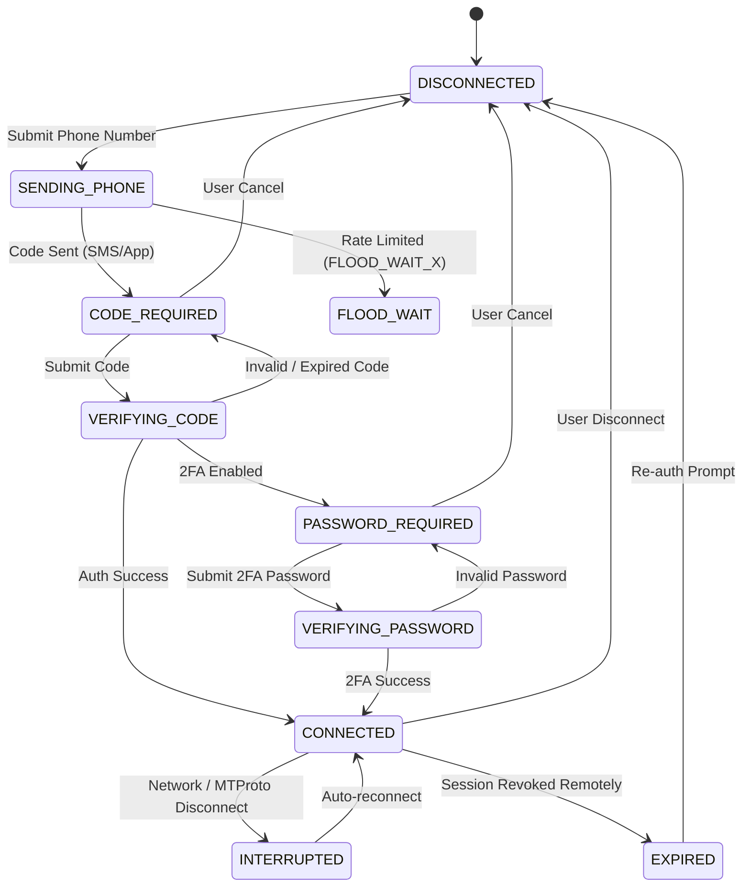

# SPEC-02: Telegram MTProto Authentication & Session Lifecycle

## 1. Domain Overview & Purpose
SOURCE OF TRUTH authenticates directly with Telegram's MTProto API using a user client (not a bot). This specification governs the complete authentication handshake, multi-step dynamic challenges (phone code, 2FA password), encrypted session persistence, disconnection semantics, and MTProto rate limiting (`FLOOD_WAIT`).

## 2. Requirements Traceability
- **SRS Requirements:**
  - `FR-AUTH-001`: Connect Telegram Account.
  - `FR-AUTH-002`: Session Persistence (encrypted at rest).
  - `FR-AUTH-003`: Session Status (Connected, Connecting, Auth Required, Interrupted, Expired, Flood Wait).
  - `FR-AUTH-004`: Reauthorization flow.
  - `FR-AUTH-005`: Account Disconnect (preserves custom profiles).
  - `FR-AUTH-006`: API ID / API Hash stored in backend secrets only.
  - `FR-AUTH-007`: Dynamic phone number authentication (any valid international format).
  - `FR-AUTH-008`: Verification code input (SMS / internal Telegram app message).
  - `FR-AUTH-009`: Two-Step Verification (2FA cloud password masked).
  - `FR-AUTH-010`: Dynamic flow adaptation.
  - `FR-AUTH-011`: Cancellation of pending auth.
  - `FR-AUTH-012`: Telegram authentication rate limits (`FLOOD_WAIT`).
  - `FR-AUTH-013`: Account identity confirmation.
  - `FR-AUTH-014`: Secure session reuse.

## 3. State Machine & Transitions



## 4. Data Model & Session Security
1. **Telegram API Secrets:** `TELEGRAM_API_ID` and `TELEGRAM_API_HASH` exist only in backend environment variables.
2. **Session Storage (`telegram_sessions` table in Neon PostgreSQL):**
   - Session strings (GramJS `StringSession`) are encrypted using **AES-256-GCM** with a 32-byte key derived from `TELEGRAM_SESSION_SECRET`.
   - Stored in the `telegram_sessions` table (`session_key = 'active_session'`, `encrypted_payload = 'iv:authTag:ciphertext'`).
   - Eliminates filesystem (`fs`) dependencies, ensuring session survival across stateless/ephemeral cloud hosting (such as Render.com free tier container sleep/wake cycles).
   - On backend boot, automatically restores and verifies the session via `autoConnectSavedSession()`.
   - Never stored in plaintext.
   - Never included in Google Drive backups or Excel exports.
   - Never logged to console.
3. **Network Resilience & Proxy Configuration:**
   - Supports optional SOCKS5 / HTTP proxy via `TELEGRAM_PROXY_HOST` and `TELEGRAM_PROXY_PORT` to guarantee continuous MTProto connectivity in restricted or filtered network environments.
4. **Account Table (`telegram_accounts`):**
   - Stores `id` (UUID), `telegram_user_id` (BIGINT), `display_name` (TEXT), `username` (TEXT), `phone_number` (TEXT), `created_at`, `updated_at`, `disconnected_at`.

## 5. API Contracts

### 5.1 Send Phone Number
- **Route:** `POST /api/backend/auth/phone`
- **Request DTO:**
  ```json
  { "phoneNumber": "+989123456789" }
  ```
- **Response DTO:**
  ```json
  {
    "success": true,
    "data": {
      "phoneCodeHash": "hash_abc123",
      "isCodeViaApp": true,
      "timeoutSeconds": 120
    }
  }
  ```

### 5.2 Submit Verification Code
- **Route:** `POST /api/backend/auth/code`
- **Request DTO:**
  ```json
  {
    "phoneNumber": "+989123456789",
    "phoneCodeHash": "hash_abc123",
    "code": "12345"
  }
  ```
- **Response DTO (Connected):**
  ```json
  {
    "success": true,
    "data": {
      "status": "CONNECTED",
      "account": {
        "id": "550e8400-e29b-41d4-a716-446655440000",
        "telegramUserId": "123456789",
        "displayName": "Ehsan",
        "username": "ehsan_key"
      }
    }
  }
  ```
- **Response DTO (2FA Required):**
  ```json
  {
    "success": true,
    "data": {
      "status": "PASSWORD_REQUIRED",
      "hint": "Personal cloud password"
    }
  }
  ```

### 5.3 Submit 2FA Password
- **Route:** `POST /api/backend/auth/password`
- **Request DTO:**
  ```json
  { "password": "user_2fa_secret" }
  ```
- **Response DTO:** Same as Connected response in 5.2.

### 5.4 Check Connection Status
- **Route:** `GET /api/backend/auth/status`
- **Response DTO:**
  ```json
  {
    "success": true,
    "data": {
      "status": "CONNECTED",
      "account": {
        "id": "550e8400-e29b-41d4-a716-446655440000",
        "telegramUserId": "123456789",
        "displayName": "Ehsan",
        "username": "ehsan_key"
      }
    }
  }
  ```

### 5.5 Disconnect Account
- **Route:** `POST /api/backend/auth/disconnect`
- **Behavior:** Destroys local MTProto session; updates `disconnected_at` on `telegram_accounts`. **CRITICAL:** Custom profiles, notes, tags, and social links in PostgreSQL remain completely intact! Completely wipes and resets the Master Passcode.

### 5.6 Dashboard Master Passcode Security Layer
To prevent unauthorized access across multiple browsers or devices when an active Telegram session is persisted on the backend server:
1. **Passcode Setup:** Required when Telegram is connected. The user sets a master passcode (minimum 4 characters) hashed with `scrypt` (16-byte random salt, 64-byte key).
   - **Route:** `POST /api/backend/auth/setup-passcode`
   - **Request:** `{ "passcode": "secret123" }`
   - **Response:** `{ "isPasscodeSet": true, "isUnlocked": true, "token": "uuid" }`
2. **Dashboard Unlock:** Other devices/browsers must supply the passcode before accessing any dashboard resources (`/telegram/*`, `/profiles/*`, `/tags/*`, `/backups/*`).
   - **Route:** `POST /api/backend/auth/unlock`
   - **Request:** `{ "passcode": "secret123" }`
   - **Response:** `{ "isPasscodeSet": true, "isUnlocked": true, "token": "uuid" }`
3. **Dashboard Status:**
   - **Route:** `GET /api/backend/auth/dashboard-status`
   - **Response:** `{ "isPasscodeSet": boolean, "isUnlocked": boolean, "telegramState": string }`
4. **Dashboard Logout (Screen Lock):**
   - **Route:** `POST /api/backend/auth/dashboard-logout`
   - **Behavior:** Revokes the browser's bearer token. Telegram MTProto session on the server remains active.
5. **Token Enforcement:** Browser sends `x-dashboard-token: <token>`. Middleware on the backend verifies the token for protected endpoints with HTTP 401 `DASHBOARD_LOCKED` code.

## 6. Verification Checklist
- [x] Validates E.164 phone number formatting before calling Telegram MTProto.
- [x] Accurately catches `FLOOD_WAIT_(\d+)` and returns `error.code: "FLOOD_WAIT"` with remaining seconds.
- [x] Session tokens are never returned in JSON payloads.
- [x] Disconnecting does not cascade-delete `custom_profiles`.
- [x] Master passcode required to unlock dashboard on secondary devices/browsers.
- [x] Dashboard logout preserves MTProto server connection while locking the client interface.
- [x] Account disconnection wipes and resets the master passcode completely.

