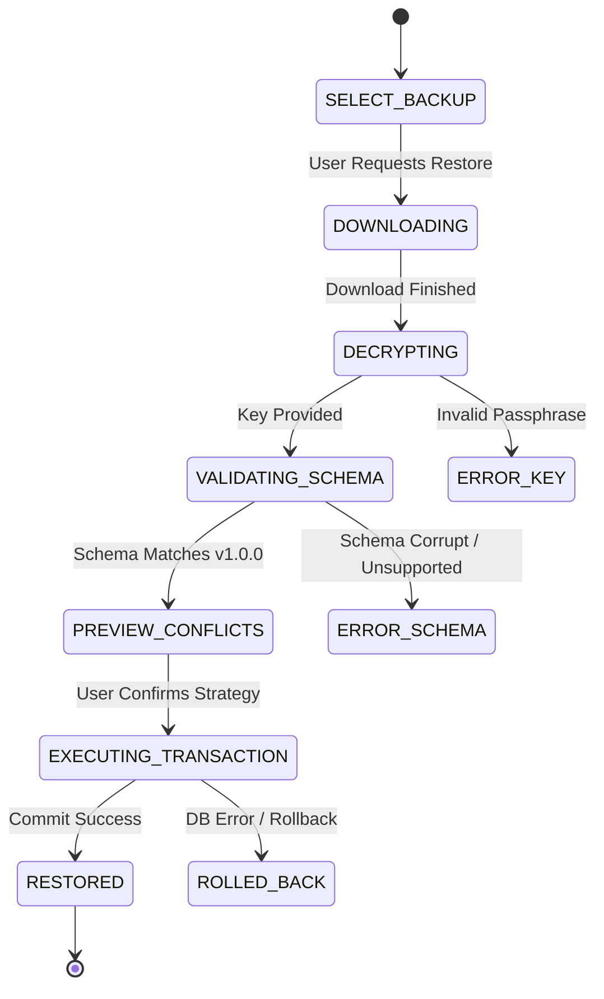

# SPEC-07: Google Drive Backup & Disaster Recovery

## 1. Domain Overview & Purpose
SOURCE OF TRUTH provides zero-data-loss resilience by backing up user-curated CRM metadata to the user's personal Google Drive account. Backups are cryptographically encrypted, schema-versioned, and validated before restoration.

**CRITICAL INVARIANT:** Backups contain ONLY application-owned metadata. Under no circumstances may Telegram message history, Telegram session credentials, or API secrets be exported into backup files.

## 2. Requirements Traceability
- **SRS Requirements:**
  - `FR-DRIVE-001`: Google Account Connection via OAuth 2.0.
  - `FR-DRIVE-002`: Least-privilege scope (`https://www.googleapis.com/auth/drive.file`).
  - `FR-DRIVE-003`: Backup inclusions (profiles, notes, names, phones, links, tags, settings).
  - `FR-DRIVE-004`: Backup exclusions (NO messages, captions, media, session keys, tokens).
  - `FR-DRIVE-005`: Manual backup trigger & status indicator.
  - `FR-DRIVE-006`: Versioned JSON backup format.
  - `FR-DRIVE-007`: Encryption before upload (AES-256-GCM).
  - `FR-DRIVE-008`: Pre-restoration preview (counts, conflicts, version check).
  - `FR-DRIVE-009`: Safe transactional restoration with rollback.
  - `FR-DRIVE-010`: Backup status reporting in UI.
  - `FR-DRIVE-011`: Live Google Drive Excel Sheet Sync (`SourceOfTruth-CRM-Contacts.xlsx`).
  - `SRS §7.9`: Table `backup_records`.

## 3. Data Model & Schemas

### 3.1 Table: `backup_records`
```sql
CREATE TABLE backup_records (
    id UUID PRIMARY KEY DEFAULT gen_random_uuid(),
    telegram_account_id UUID NOT NULL REFERENCES telegram_accounts(id) ON DELETE CASCADE,
    provider VARCHAR(32) NOT NULL DEFAULT 'google_drive',
    drive_file_id VARCHAR(255) NOT NULL,
    backup_format_version VARCHAR(16) NOT NULL DEFAULT '1.0.0',
    status VARCHAR(32) NOT NULL CHECK (status IN ('PENDING', 'SUCCESS', 'FAILED')),
    profiles_count INT NOT NULL DEFAULT 0,
    tags_count INT NOT NULL DEFAULT 0,
    metadata JSONB,
    created_at TIMESTAMPTZ NOT NULL DEFAULT NOW()
);

CREATE INDEX idx_backup_records_account ON backup_records(telegram_account_id);
```

### 3.2 Canonical Backup Payload Schema (`v1.0.0`)
```typescript
interface BackupArchive {
  formatVersion: "1.0.0";
  appVersion: string;
  exportedAt: string; // ISO-8601
  telegramAccount: {
    telegramUserId: string;
    displayName: string | null;
  };
  profiles: Array<{
    entityPeerId: string;
    entityType: "user" | "group" | "channel";
    customDisplayName: string | null;
    phoneNumber: string | null;
    company: string | null;
    jobTitle: string | null;
    relationshipType: string | null;
    reasonForJoining: string | null;
    notes: string | null;
    socialLinks: Array<{
      label: string;
      url: string;
      description: string | null;
    }>;
    tags: string[]; // Tag names
  }>;
  tagsCatalog: Array<{
    name: string;
    color: string | null;
  }>;
  applicationSettings: Record<string, string>;
}
```

## 4. Encryption Architecture
1. The JSON payload is serialized to a UTF-8 byte stream.
2. The payload is encrypted using **AES-256-GCM** with a PBKDF2-derived key from the user's passphrase or master secret.
3. The uploaded file contains:
   `[ 12 bytes IV | 16 bytes Auth Tag | Ciphertext ]`
4. The file is uploaded to the user's Google Drive inside an app folder named `SourceOfTruth-Backups`.

## 5. Restoration Workflow & State Machine



### Restoration Safety Rules:
- **Default Strategy (Safe Merge):** Updates existing profiles only if backup has newer data, preserves local profiles not present in the backup.
- **Rollback Guarantee:** The entire restore executes inside `db.transaction()`. If any foreign key or entity validation fails, all changes rollback 100%.

## 6. Unidirectional Google Drive Excel CRM Export & Live Update (`TeleNexus-CRM-Contacts.xlsx`)

In addition to encrypted disaster-recovery archives, the system provides transparent, unencrypted Excel workbook export and update for personal CRM viewing directly within Google Sheets or Excel:

1. **Folder Location:** Uploaded to the user's `TeleNexus-Backups` Google Drive directory as `TeleNexus-CRM-Contacts.xlsx`.
2. **CRITICAL RULE — Database as Single Source of Truth (SSOT):**
   - TeleNexus is strictly **UNIDIRECTIONAL** (Neon PostgreSQL ➔ Google Drive).
   - Under NO circumstances does TeleNexus download, import, or parse edits from Google Sheets back into PostgreSQL. The database is the authoritative source of truth.
   - The Drive Excel file is solely an export target for user inspection, reporting, and sharing.
3. **CRITICAL RULE — Custom Profile Invariant:**
   - **ONLY entities that possess a Custom Profile are exported to or updated in the Excel spreadsheet and Google Drive.**
   - Generic/unprofiled Telegram dialogs are strictly excluded to maintain CRM data hygiene.
4. **Workbook Schema & Columns:**
   - Columns:
     1. `Telegram Peer ID`: Numeric Telegram Peer ID (e.g. `987654321`)
     2. `Username`: Telegram `@username` handle
     3. `Original Name`: Original Telegram display title (user, channel, or group name)
     4. `Custom Name`: User-assigned custom CRM name
     5. `Entity Type`: Normalized entity classification (`user`, `group`, `supergroup`, `channel`)
     6. `Phone Number`: Phone number recorded in profile
     7. `Company`: Company name
     8. `Job Title`: Job title / role
     9. `Relationship`: Relationship classification
     10. `Reason For Joining`: Reason for joining / interaction context
     11. `Tags`: Semicolon-separated tag names (e.g. `VIP; Engineering`)
     12. `Notes`: Multiline notes
     13. `Social Links`: Pipe-separated social link URLs (`Label: URL | Label: URL`)
     14. `Last Updated`: ISO-8601 timestamp
5. **Lifecycle Update Triggers:**
   - **Application Launch / Site Access:** Auto-updates the Drive Excel file on startup/page load if Google Drive is authorized.
   - **Profile Lifecycle Events:** Creating, modifying, or deleting a custom profile, social links, or tags triggers background update of the Drive Excel file.
   - **Manual User Trigger:** The user can manually click 'Update Drive Excel' in the UI to push the latest database state at any time.
6. **Direct Download:**
   - The user can download the unencrypted `.xlsx` workbook via `GET /api/backend/backups/excel/download`.

## 7. Verification Checklist
- [x] Backup export serializer contains explicit unit test verifying 0 message fields in JSON output.
- [x] Session tokens and database credentials are fully absent from backup records.
- [x] A failed restoration leaves the PostgreSQL database in its exact pre-restore state.
- [x] Excel export preserves all CRM custom fields (notes, company, phone, tags, links) without persisting Telegram messages.
- [x] Telegram Peer ID, Username, and Entity Type are properly exported in Excel workbooks.
- [x] Only entities with an active Custom Profile are exported to Google Drive.
- [x] Unidirectional export guarantees Google Sheets edits never overwrite local PostgreSQL data.

